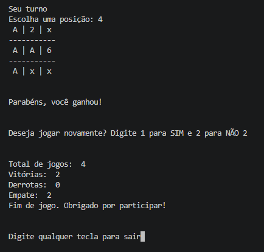

# Jogo da Velha (Terminal)

Jogo da velha para terminal escrito em Python

## Funcionalidades

- Seleção do seu marcador
- Tratamento de dados inválidos (números inválidos ou já seleciodados, letras)
- Verificação automática de vitória ou empate
- Seleção de nível de dificuldade de 1 a 10

## Sobre o oponente ("robô")

O oponente **não utiliza inteligência artificial**. O "robô" apenas lê as
posições já ocupadas no tabuleiro e, conforme o nível de dificuldade escolhido
(1 a 10), ajusta a aleatoriedade da escolha: nos níveis mais altos, a
probabilidade de escolher uma jogada que leve à vitória — ou, no mínimo, ao
empate — é maior. Não há aprendizado, nem modelo treinado, apenas lógica e
aleatoriedade ponderada.

## Requisitos

- Python 3.14.4 (versão usada no desenvolvimento; versões anteriores não foram testadas)

## Como jogar

1. Clone o repositório:

   git clone https://github.com/dutakeuchi/Jogo_da_velha.git

2. Entre na pasta:

    cd Jogo_da_velha

3. Execute o jogo:

    Jogo da Velha.py

